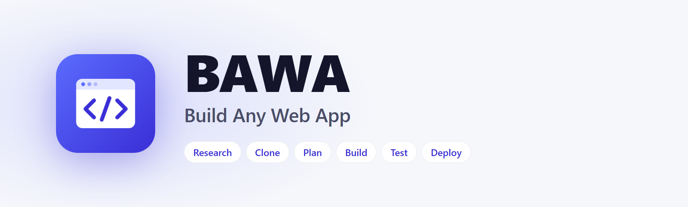

<div align="center">

<picture>
  <source media="(prefers-color-scheme: dark)" srcset="docs/assets/banner-dark.png">
  <source media="(prefers-color-scheme: light)" srcset="docs/assets/banner-light.png">
  
</picture>

### See an app you like. Rebuild it as your own web app.

Agent skills that take a web app from idea to a public URL.<br>
React and TypeScript. Your data stays in your browser. Works on Windows, macOS, and Linux.

[](#requirements)
[](#requirements)
[](#requirements)
[](#skills)
[](#install)
[](#install)
[](LICENSE)

**[Quick start](#quick-start) · [How it works](#how-it-works) · [What you get](#what-you-get) · [Skills](#skills) · [Install](#install)**

</div>

## Quick start

```bash
npx skills@latest add NilupulNishan/bawa
```

Then open an empty folder and ask your agent:

```text
Clone my to-do app as a web app.
Screenshot every page, write the user stories, and build milestone 1.
```

Not sure where to start? Type `/bawa`. It looks at your project and picks
the next skill.

## How it works

<table>
<tr>
<td width="33%" valign="top">

**1. Clone**

Your agent opens the app you like in a browser and screenshots every page.
It writes a screen index.

</td>
<td width="33%" valign="top">

**2. Plan**

It turns the screens into user stories with checkable acceptance criteria,
in milestones.

</td>
<td width="33%" valign="top">

**3. Build**

It builds one story per commit. Before each commit it runs a browser
self-test and snapshots every page in light and dark mode.

</td>
</tr>
</table>

The full path, one skill per step:

```text
idea -> research -> clone -> app-brief -> user-stories -> new-web-app
     -> design -> improve-loop (build, test, snapshot, commit) -> deploy
```

## What you get

Every project starts from a template that works on day one. Your agent
never builds the setup from scratch, so it never guesses package versions
or breaks the build.

| Part | What it gives you |
| --- | --- |
| **Vite, React, TypeScript** | A fast, strict, modern setup |
| **Local-first data** | IndexedDB through Dexie. No server, no accounts, works offline |
| **Browser self-test** | Playwright drives the real build: add, rename, reload, star, delete, Undo |
| **Snapshots** | A PNG of every page in light and dark, which the agent looks at before it calls a change done |
| **Grid checks** | A lint and a layout probe that fail when edges do not line up |
| **Design tokens** | One file for color, spacing, radii, and motion, plus an accent picker in Settings |
| **Test databases** | `?store=test` keeps seed data and tests away from your real data |
| **Deploy anywhere** | Hash routes and a relative base run on any static host or subpath |

One command checks it all:

```bash
npm run check    # unit tests, self-test, snapshots, grid checks
```

## Skills

<table>
<tr><th>Stage</th><th>Skill</th><th>What it does</th></tr>
<tr><td rowspan="3" valign="top"><b>Start</b></td><td nowrap><a href="skills/start/bawa/SKILL.md"><samp>bawa</samp></a></td><td>Router: finds where you are and calls the right skill</td></tr>
<tr><td nowrap><a href="skills/start/app-brief/SKILL.md"><samp>app-brief</samp></a></td><td>Turns an idea into a one-page brief</td></tr>
<tr><td nowrap><a href="skills/start/new-web-app/SKILL.md"><samp>new-web-app</samp></a></td><td>A working app from a template: Vite, React, IndexedDB, self-test, snapshots, git</td></tr>
<tr><td rowspan="3" valign="top"><b>Plan</b></td><td nowrap><a href="skills/plan/research/SKILL.md"><samp>research</samp></a></td><td>Parallel researcher agents: market, reviews, features, design, browser APIs</td></tr>
<tr><td nowrap><a href="skills/plan/clone/SKILL.md"><samp>clone</samp></a></td><td>Screenshots every page of any web app with a browser, writes a screen index</td></tr>
<tr><td nowrap><a href="skills/plan/user-stories/SKILL.md"><samp>user-stories</samp></a></td><td>A backlog with checkable acceptance criteria, in milestones</td></tr>
<tr><td rowspan="4" valign="top"><b>Code</b></td><td nowrap><a href="skills/code/typescript-react/SKILL.md"><samp>typescript-react</samp></a></td><td>State, effects, IndexedDB, forms, keyboard, and fixes for common errors</td></tr>
<tr><td nowrap><a href="skills/code/web-integrations/SKILL.md"><samp>web-integrations</samp></a></td><td>Install as an app, offline, keeping data, files, clipboard, notifications, share</td></tr>
<tr><td nowrap><a href="skills/code/performance/SKILL.md"><samp>performance</samp></a></td><td>Measure, then fix: load time, input lag, long lists, bundle size, memory</td></tr>
<tr><td nowrap><a href="skills/code/improve-architecture/SKILL.md"><samp>improve-architecture</samp></a></td><td>Finds hot spots as the app grows and refactors one step per commit, with behavior proven unchanged</td></tr>
<tr><td rowspan="5" valign="top"><b>Design</b></td><td nowrap><a href="skills/design/ux-design/SKILL.md"><samp>ux-design</samp></a></td><td>Names, flow, where each feature opens (inline, popover, dialog, page), words, and accessibility, before code</td></tr>
<tr><td nowrap><a href="skills/design/web-design/SKILL.md"><samp>web-design</samp></a></td><td>Layout, navigation, type, color, dark mode, responsive, motion</td></tr>
<tr><td nowrap><a href="skills/design/design-system/SKILL.md"><samp>design-system</samp></a></td><td>An accent people pick in Settings, one set of tokens, and one rules page</td></tr>
<tr><td nowrap><a href="skills/design/layout-grid/SKILL.md"><samp>layout-grid</samp></a></td><td>A 4 px grid with checks that fail on misalignment: a lint, a layout probe in snapshots, and a grid overlay</td></tr>
<tr><td nowrap><a href="skills/design/app-icon/SKILL.md"><samp>app-icon</samp></a></td><td>One SVG icon rendered to every favicon and home screen size</td></tr>
<tr><td rowspan="4" valign="top"><b>Ship</b></td><td nowrap><a href="skills/ship/build-and-verify/SKILL.md"><samp>build-and-verify</samp></a></td><td>Build, snapshot every page in light and dark, look at them</td></tr>
<tr><td nowrap><a href="skills/ship/test-web-app/SKILL.md"><samp>test-web-app</samp></a></td><td>Vitest, a Playwright self-test, and accessibility checks with axe</td></tr>
<tr><td nowrap><a href="skills/ship/improve-loop/SKILL.md"><samp>improve-loop</samp></a></td><td>Works through the backlog one story per commit until a milestone is done</td></tr>
<tr><td nowrap><a href="skills/ship/deploy/SKILL.md"><samp>deploy</samp></a></td><td>GitHub Pages, Netlify, Vercel, or Cloudflare Pages, then the self-test against the live URL</td></tr>
</table>

## Try these prompts

```text
/bawa I want an app to track the books I read
```

```text
Research the best habit tracker apps, then write a brief for my own.
```

```text
Keep going: finish milestone 1, then stop and show me the screenshots.
```

```text
Deploy it to GitHub Pages and give me the link.
```

## Install

Pick one route per agent. Two routes install every skill twice.

<details open>
<summary><b>Claude Code</b></summary>

```text
/plugin marketplace add NilupulNishan/bawa
/plugin install bawa@bawa
```

</details>

<details>
<summary><b>Codex</b></summary>

```bash
codex plugin marketplace add NilupulNishan/bawa
codex plugin add bawa@bawa
```

</details>

<details>
<summary><b>Any other agent</b> (Cursor, Gemini CLI, Copilot, and more)</summary>

Uses [skills.sh](https://skills.sh). Install all skills, or one with `--skill`.

```bash
npx skills@latest add NilupulNishan/bawa -a <agent>
npx skills@latest add NilupulNishan/bawa --skill=clone
```

</details>

<details>
<summary><b>By hand</b></summary>

```bash
git clone https://github.com/NilupulNishan/bawa.git
node bawa/scripts/link-skills.mjs   # links every skill into ~/.claude/skills and ~/.agents/skills
```

</details>

## Requirements

- Node 20 or later, and git
- Windows, macOS, or Linux
- An agent that supports skills: Claude Code, Codex, Cursor, Gemini CLI
- For `clone`: a browser tool (Claude in Chrome, the built-in browser) or
  Playwright

## Contributing

Each skill is one folder: `skills/<stage>/<name>/SKILL.md`. Read
[`.claude/CLAUDE.md`](.claude/CLAUDE.md) for the writing rules and how to
test a change to the template. Issues and pull requests are welcome.

## Credits

Skill format and writing rules follow Matt Pocock's
[skills](https://github.com/mattpocock/skills) and his
`writing-for-agents` skill.

## License

[MIT](LICENSE)
